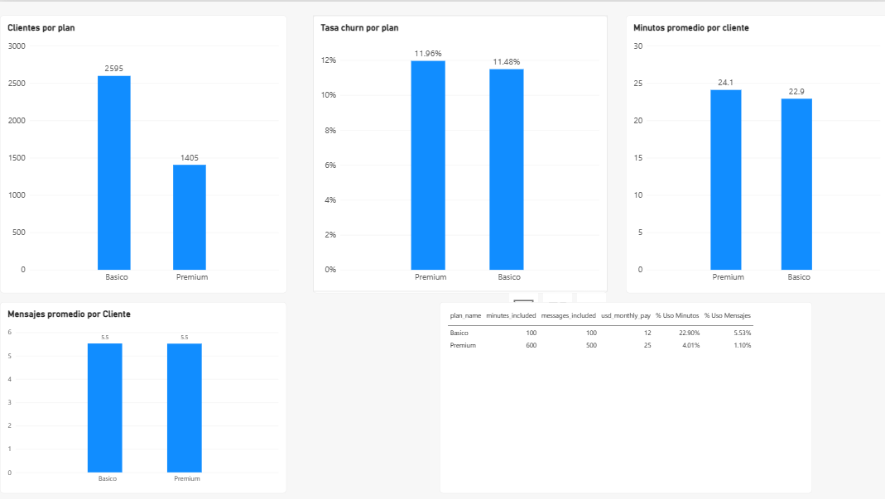

# Megaline: Plan Usage & Churn Analysis (Power BI)

## Business question
Megaline, a telecom company, offers two plans: **Basico** (12 USD/month) and **Premium** (25 USD/month). Does the Premium plan bring more usage or more loyalty than Basico?

## Data
- `users_latam`: 4,000 clients with plan, city, age, registration and churn dates
- `usage`: 40,000 call and text events
- `plans`: price and included minutes/messages for each plan

## Data cleaning (Power Query)
- Replaced placeholder values (age `-999`, city `?`) with null
- Converted `churn_date` from a nanosecond timestamp stored as text into a real date
- Set placeholder registration dates to null
- Built relationships between users, usage and plans

## Key measures (DAX)
Total Clientes, Clientes Perdidos, Tasa Churn, Minutos por Cliente, Mensajes por Cliente, % Uso Minutos, % Uso Mensajes

## Findings
| Metric | Basico | Premium |
|---|---|---|
| Clients | 2,595 | 1,405 |
| Churn rate | 11.48% | 11.96% |
| Avg minutes per client | 22.9 | 24.1 |
| Avg messages per client | 5.5 | 5.5 |
| % of included minutes used | 22.88% | 4.01% |
| % of included messages used | 5.53% | 1.10% |

- Premium clients **don't use more** minutes or messages than Basico clients.
- Premium clients **don't stay longer**: their churn rate is slightly higher.
- Premium clients use only **4% of their included minutes**, while paying more than twice the price.

## Recommendation
Premium's value isn't coming from extra minutes or messages. Megaline should redesign it, for example with a cheaper mid-tier plan or with benefits other than larger limits, and test whether that reduces churn.

## Tools
Power BI Desktop, Power Query, DAX
